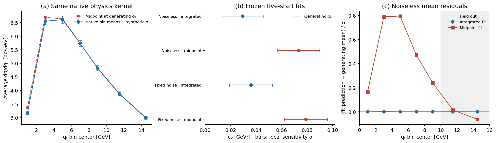

# typed-TMD: typed observation maps for TMD calculations

[](https://www.python.org/) [](https://github.com/zetanaut/typed-TMD/actions/workflows/core.yml) [](#scientific-scope)

This repository provides **typed scientific contexts and observation maps**
for reproducible TMD calculations. It keeps the observation measure, units,
process, model identity, parameter dependencies and construction history
explicit when assembling a prediction or fit.

The main example uses a pinned **arTeMiDe/SV19 Drell–Yan calculation** to study
a concrete observation error: substituting a midpoint point density for a
finite-bin average. The checked fit constructor rejects that mismatch before
backend or optimizer evaluation. A controlled synthetic experiment measures
the change after constructing the full bin integral.

The finite-plan layer addresses a second failure: caching a fitted-parameter
factor at one reference point can preserve its value while corrupting its
sensitivity. A concrete dependency/erasure checker rejects that reuse. Its
Lean theorem preserves the entire admitted parameter family under a fixed pure
interpretation. Categorical composition requires transporting the second cache
reference through the first source map. These guarantees concern exact finite
expressions; Python, floating-point arithmetic, quadrature and QCD remain
separate obligations.

Three reader paths:

- **Try the runtime examples:** [cache/refusal and composition](docs/formal/EXAMPLES.md), plus the quick start below.
- **Check the full finite-plan proof:** [clean checkout reproduction](docs/formal/REPRODUCE.md), requiring Python numerics and Lean 4.21.0 only.
- **Reproduce the native physics benchmark:** [external setup](docs/INSTALL_EXTERNAL.md), with separately fetched backend and PDF inputs.

Scientific and software documentation:

- [Observation conventions and native-source audit](docs/EXTERNAL_SV19.md)
- [Construction, rejection and repair](docs/EXAMPLES.md)
- [Native installation and reproduction](docs/INSTALL_EXTERNAL.md)
- [Results, numerical resolution and timing](docs/RESULTS.md)
- [Claim/evidence map](docs/CLAIM_EVIDENCE.md)
- [Release and accepted-results status](docs/RELEASE_STATUS.md)
- [Development roadmap](docs/ROADMAP.md)

---

## Status at a glance

| Layer | Status | Meaning |
|---|---|---|
| GitHub release | **Published; bounded results accepted** | v0.4.0 adds the concrete finite-plan implementation; v0.3.0 physics evidence is preserved. |
| Scientific contexts and observation contracts | **Implemented** | Runtime checks retain observation meaning, model identity and parameter dependencies. |
| External DY example | **Validated** | One pinned arTeMiDe v2.05/SV19 configuration, seven bins and one free native parameter. |
| Midpoint/bin mismatch | **Rejected before fitting** | The invalid constructor makes zero backend and optimizer calls. |
| Independent observation integration | **Validated** | Separate quadrature and refinements share the same native physics kernel. |
| Controlled fit comparison | **Complete** | Correct and unchecked routes use identical noiseless and fixed-noise synthetic inputs. |
| Saved-array coverage diagnostic | **Replayed** | The same 200 saved draws support a separate post-hoc statistical diagnostic. |
| Checking overhead | **Measured** | Thirty alternating paired blocks per workload, with equal native call counts. |
| Lean formal layer | **Concrete checker and category laws** | 24 theorem statements; four full positive roots, one negative root; exact finite semantics under stated assumptions. |

---

## Main result

The frozen external study uses five training bins and two held-out bins from
the published ATLAS 8-TeV geometry. The complete SV19 parameter vector is
retained, with only the native parameter $c_0$ varied. The generating value is
$c_0 = 0.029551\;\mathrm{GeV}^2$.

| Synthetic inputs | Observation route | Fitted $c_0$ (GeV²) | Training chi² |
|---|---|---:|---:|
| Noiseless | Integrated bin average | 0.0295347971 | 0.0000008953 |
| Noiseless | Unchecked midpoint | 0.0733985316 | 1.562833 |
| Fixed noise | Integrated bin average | 0.0359364496 | 2.382828 |
| Fixed noise | Unchecked midpoint | 0.0790220118 | 5.228829 |

The noiseless midpoint-minus-integrated shift is **0.04386373 GeV²**, or
**2.68177 local sensitivity units** for the declared synthetic covariance.
All five starts converge in each case, without a selected bound hit. The
held-out differences are small. These local sensitivity units are not
calibrated confidence statements, and multistart agreement does not prove
a global minimum.



The [full results](docs/RESULTS.md) include fitted-point refinements, the
numerical-resolution budget, held-out responses and measured checking cost.

---

## Scientific scope

The external example uses:

- the pinned arTeMiDe v2.05 backend and its bundled SV19 DY/NNLO configuration;
- NNPDF31_nnlo_as_0118_1000, member 0, with the complete published mean model vector;
- seven bins selected by the fixed geometry rule $q_{T,\mathrm{upper}}/Q_{\mathrm{lower}} \leq 0.25$;
- the published mass window, rapidity interval, fiducial cuts and normalization;
- one free $c_0$ parameter, five deterministic starts and two held-out bins;
- native synthetic means, a fixed 2% uncertainty rule with the declared floor,
  and one PCG64 noise realization.

The native point response is a density in `dqT² dQ² dy`. Integrating in
`qT, Q, y` therefore requires the **`4*qT*Q` Jacobian**, followed by the
source rapidity factor and division by the requested bin width. The
observation construction is:

```text
native point response
  → integrate the declared measure with native cuts
  → bin yield
  → average per dqT
  → checked fit problem
```

Equal units and array shapes do not make a midpoint value the same
observation as a bin average. Exact conversions between averages of the
same integrated yield also transform the data and covariance.

The external comparisons share one physics engine. They establish adapter
and observation-integration checks, not an independent QCD calculation or
a reproduction of the published global extraction. The inference inputs
are synthetic; experimental measurements are not fitted here. The separate
Gaussian closure example is an exact analytic fixture, not physical LL/NLL
evolution.

See the [source audit](docs/EXTERNAL_SV19.md) and
[frozen configuration](configs/external/external.lock.json) for the explicit
coefficient inventory, scales, process conventions and input identities.

---

## Repository layout

```text
.
├── src/typed_tmd/          scientific contexts, observation maps and native adapter
├── configs/external/      frozen experiment, observation contract and input locks
├── examples/              analytic closure example
├── scripts/               dependency builds, native reproduction, replay and plotting
├── tests/                 core and analytic adapter checks
├── evidence/              saved predictions, fits, refinements, coverage and timings
├── docs/
│   ├── INSTALL_EXTERNAL.md
│   ├── EXTERNAL_SV19.md
│   ├── RESULTS.md
│   ├── CLAIM_EVIDENCE.md
│   ├── ROADMAP.md
│   └── figures/external/
├── formal/007/            concrete checker, category laws and examples (Lean 4.21.0)
├── lean/                  historical abstract composition seed
├── pyproject.toml
└── requirements-*.txt
```

Native engines, PDF grids, build products and local caches are acquired or
created separately. The [source map](SOURCE_MAP.json) records the relationship
between the publication tree and the working source.

---

## Quick start

Use Python 3.11 in a project environment:

```sh
python3.11 -m venv .venv
.venv/bin/python -m pip install -r requirements-build.txt -r requirements-numerics.txt
.venv/bin/python -m pip install .
```

Run the core checks and analytic closure:

```sh
.venv/bin/python -m unittest discover -s tests -v
.venv/bin/python examples/algebraic_closure.py --output results/closure.json
```

The source suite includes the finite-plan and publication regressions and twelve
analytic closure checks. These commands do not require the external engine.
The dense certificate integration test is explicitly optional on this runtime
route; the separate full formal command requires it to execute.

Run the new runtime tutorial and snapshot replay:

```sh
.venv/bin/python examples/formal/cache_and_composition.py
.venv/bin/python scripts/replay_finite_plans.py --output results/finite-replay.json
```

With Lean 4.21.0 available, check the complete selected roots from the shipped
coefficients (no LHAPDF or arTeMiDe installation):

```sh
.venv/bin/python scripts/check_formal.py --output-dir results/formal-check
```

Use a fresh output directory. Installation is from a source checkout; the
wheel alone does not contain these fixtures and commands. See the
[formal guide](docs/formal/README.md) for semantics, category laws and trust.

Replay the saved-array coverage diagnostic:

```sh
.venv/bin/python scripts/replay_coverage.py \
  --inputs evidence/coverage/inputs.json \
  --output results/coverage.json
```

This reuses the same 200 saved noise vectors and Jacobian from the separate
two-parameter synthetic study. It does not redraw noise or refit. The
unbounded linear and saved nonlinear controls both give 184/200 nominal
95% inclusion; this post-hoc observation does not establish calibration.

For the complete native mismatch/repair calculation, follow
[the installation and reproduction guide](docs/INSTALL_EXTERNAL.md). It
fetches pinned sources and PDF inputs, verifies their digests, and builds
the optional backend in a project-specific environment.

---

## Main outputs

| Output | Location |
|---|---|
| Synthetic means, noise and covariance | [Experiment data](evidence/experiment/data.json) |
| All fit starts, selected fits and predictions | [Fit results](evidence/experiment/fits.json) |
| Parameter, objective and held-out differences | [Measured consequences](evidence/experiment/consequences.json) |
| Pre-fit refusal and call counters | [Rejection diagnostic](evidence/experiment/rejection.json) |
| Observation and native refinements | [Validation](evidence/validation/), [native refinement](evidence/refinement/) |
| Raw paired timing blocks | [Timing arrays](evidence/timing/timings.json) |
| Saved coverage inputs and provenance | [Coverage evidence](evidence/coverage/) |
| Tables and scientific figures | [Figures and fit table](docs/figures/external/) |

The plotting command in the [reproduction guide](docs/INSTALL_EXTERNAL.md)
regenerates figures from saved arrays without running another fit.

---

## Validation summary

| Check | Outcome | Scope |
|---|---|---|
| Plain native and typed invocations | Pass | Exact agreement, including off-central and reset probes. |
| Independent bin quadrature | Pass | Coordinate refinements and native integration checks at truth and all selected fits. |
| Midpoint/bin refusal | Pass | Zero backend and optimizer calls at the invalid boundary. |
| Numerical resolution of fit consequences | Pass | Measured objective changes exceed the declared empirical response budgets. |
| Fresh native installation | Pass | All saved scientific campaign values, including optimizer histories, reproduce in binary64; elapsed times are excluded. |
| Public tests and GitHub CI | Pass | Core and analytic fixtures; CI does not build the native engine. |
| Saved-array coverage replay | Pass | Exact saved inputs and explicit comparison tolerances; no recalibration. |
| Concrete Lean layer | Kernel checked | Dependency/cache preservation, source substitution/category laws and transported-reference composition; four selected full literal roots and a negative certificate. |

The native backend has process-global state. Use one owning session per
process. Parameter-independent quadrature geometry is cached; parameter
vectors are rebound for evaluations. Out-of-band harpy/FFI mutation lies
outside the supported adapter contract.

The [claim/evidence map](docs/CLAIM_EVIDENCE.md) connects each claim to its
receipt and limitations. [Earlier failed attempts and corrections](docs/ATTEMPT_HISTORY.md)
remain documented. The [formal documentation](docs/formal/README.md) and
[machine claim index](CLAIM_EVIDENCE.json) distinguish exact theorems, runtime
checks, numerical comparisons and historical native evidence.

---

## Releases and citation

[Release v0.4.0](https://github.com/zetanaut/typed-TMD/releases/tag/v0.4.0)
contains the source archive, SHA-256 manifest and publication verification receipt.
The [v0.3.0 release](https://github.com/zetanaut/typed-TMD/releases/tag/v0.3.0)
and its native results remain unchanged.
Use [CITATION.cff](CITATION.cff) for software citation metadata. No software
DOI has been assigned; DOI archiving is explicitly deferred. The
[release-status record](docs/RELEASE_STATUS.md) distinguishes the immutable
tagged snapshot from later documentation on `main`.

For the native calculation, cite the SV19 analysis by I. Scimemi and
A. Vladimirov, [JHEP 06 (2020) 137](https://doi.org/10.1007/JHEP06%282020%29137).
Additional scientific references are listed in the
[third-party notices](docs/THIRD_PARTY_NOTICES.md).

---

## License

The original software is available under the [MIT license](LICENSE).
External code, models and PDF inputs retain their own terms; see
[third-party notices](docs/THIRD_PARTY_NOTICES.md).
