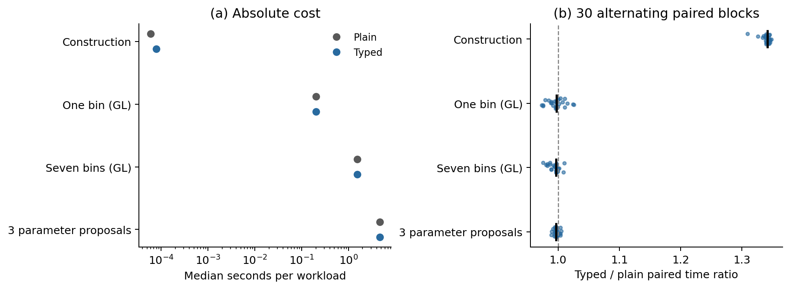

# External observation experiment

The frozen case uses seven bins from the published ATLAS 8-TeV geometry,
the complete pinned SV19 model vector and one free native parameter, c0.
The final two bins are held out. All inference data are synthetic; sigma is
fixed at 2% of the generating mean with the declared small absolute floor.
One PCG64 noise realization uses seed 2026102006.

The source-audited native bin and point APIs share one physics kernel.
Independent Gauss-Legendre observation integration includes the `4 qT Q`
Jacobian and the source rapidity factor. These comparisons do not constitute
two independent TMD engines or a new reproduction of the published global fit.

At fit construction, supplying a midpoint point-density response for the
finite-bin average is rejected with zero backend and optimizer calls.
The explicitly unchecked experiment preserves that point label and bypasses
the constructor solely to measure the injected error.

| Synthetic data | Observation route | c0 (GeV²) | Training chi² | Held-out mean residual norm |
|---|---|---:|---:|---:|
| Noiseless | Correct bin integral | 0.0295347971 | 0.0000008953 | 0.000364 |
| Noiseless | Unchecked midpoint | 0.0733985316 | 1.562833 | 0.064694 |
| Fixed noise | Correct bin integral | 0.0359364496 | 2.382828 | 0.029965 |
| Fixed noise | Unchecked midpoint | 0.0790220118 | 5.228829 | 0.063541 |

The generating value is c0 = 0.029551 GeV². The noiseless uncorrected-minus-
corrected shift is 0.04386373 GeV², or 2.68177 units of the generating local
training sensitivity. The fixed-noise shift is 0.04308556 GeV², or 2.63419
such units. These are local sensitivity comparisons for the controlled
covariance, not confidence statements from a calibrated extraction.

All five starts converge for all four cases, with no selected bound hits.
Multistart agreement does not prove a global minimum. At fixed truth the
midpoint substitution has whitened norm 3.20936 and training chi² 10.24925;
the wrong fit absorbs much of that response difference into c0. The held-out
differences are small on the chosen synthetic uncertainty scale, so this
case does not demonstrate strong held-out discrimination.

All observation-validation checks pass at the generating point and the four
selected fitted points. Each integration coordinate is refined separately;
native qT sections are also increased from at least 32 to at least 64.
The largest component-budget ratio is 0.86094, below one. The largest
whitened integration difference is 0.004403, below 0.05; the largest native
refinement difference is 0.001274, below 0.05/3. The unchanged component
budget is `1e-8*S + 1e-4*abs(reference)`, where S is the declared spectrum
scale. The nominal and refined raw arrays are included.

Using the declared whitened response budget of 0.05 for each route,
`|delta chi²| <= 2 ||r|| ||e|| + ||e||²` gives a sum of objective-change
budgets of 0.13011 (noiseless) and 0.38803 (fixed noise). The measured
objective differences, 1.56283 and 2.84600, exceed those budgets. This is
resolution against the declared empirical convergence checks, not a
rigorous integration-error bound or proof of a global fit optimum.

An independently downloaded and rebuilt native installation reproduced all
data, fit histories, selected fits, sensitivities and consequences with exact
binary64 equality, excluding elapsed time. Its public test suite, synthetic
closure and saved-array coverage replay also pass. The [claim/evidence map](CLAIM_EVIDENCE.md)
links the executable scopes and their limits.

## Saved-array coverage diagnostic

The same retained 200 noise vectors, truth Jacobian and nonlinear likelihood
ratios give the following post-hoc comparison without refitting:

| Statistic | Empirical q95 | Nominal 95% inclusion |
|---|---:|---:|
| Unbounded rank-two linear tangent | 7.015289 | 184/200 |
| Same-box linear tangent | 6.970971 | 184/200 |
| Saved nonlinear fit | 6.823951 | 184/200 |

For fixed rank-two G and standard Gaussian z, `||Q.T @ z||²` is exactly
chi-square(2). Its elevated sample q95 already occurs on these saved draws;
the unbounded linear and nonlinear controls exclude the same sixteen IDs.
The original nonlinear coverage remains 92%, with Wilson interval
[0.87401, 0.95016]. This is a finite-sample, post-hoc diagnosis. Correlation
alone is not an explanation, and no general recalibration follows.

## Formal and release scope

Runtime records preserve observation operators, parameter dependencies,
source/plan identities and declared evidence. The pinned Lean seed builds,
but no Lean proof of this adapter, Python, native code or QCD is claimed.
The concrete dependency-preserving checker remains specified future work,
with no new implementation task assigned. The bounded results are accepted
and [GitHub v0.3.0 is published and verified](RELEASE_STATUS.md). DOI archiving
is explicitly deferred. Acceptance and publication do not expand the
numerical/software claims above.

## Checking cost on the tested machine

Each row uses 30 alternating paired blocks, with logged pilot-selected
repetition counts and two warmups per route. Numerical rows use the same
serial native point kernel, quadrature, parameter bindings and cache regime.
Outputs agree exactly outside timing, and measured backend call counts match.
The construction row compares raw request-record creation with immutable
contract construction plus plan validation; it has no numerical-output
equivalence claim.

| Workload | Plain median (s) | Typed median (s) | Median paired extra (s) | Median paired ratio | Ratio IQR |
|---|---:|---:|---:|---:|---|
| Construction and validation | 0.000059438 | 0.000079810 | +0.000020342 | 1.34218 | [1.33967, 1.34456] |
| One bin, independent quadrature | 0.203364 | 0.203041 | -0.000484605 | 0.99761 | [0.99032, 1.00113] |
| Seven bins, independent quadrature | 1.547269 | 1.542510 | -0.005121792 | 0.99669 | [0.98992, 0.99837] |
| Objective at three parameter proposals | 4.652280 | 4.641186 | -0.014049729 | 0.99697 | [0.99545, 0.99896] |

Native import, configuration and initial grid binding took 36.309 seconds in
this timing process, separately from the warm measurements. A median paired
difference is not generally the difference of two medians. Ratios slightly
below one are reported as observed timing variation, without a speedup claim.
These results measure this configuration on macOS arm64; no universal
overhead bound follows. Peak memory was not measured. Raw nanosecond blocks,
clock resolution, warmups, call counters and scope are in the timing JSON.

